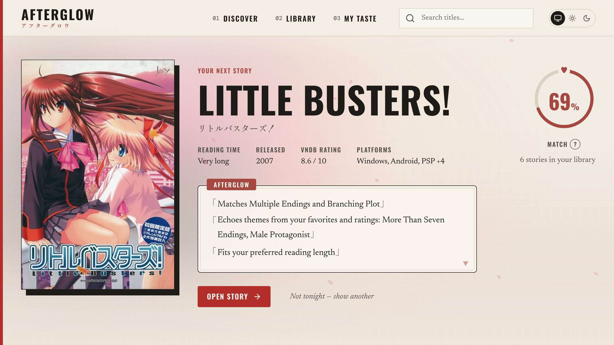
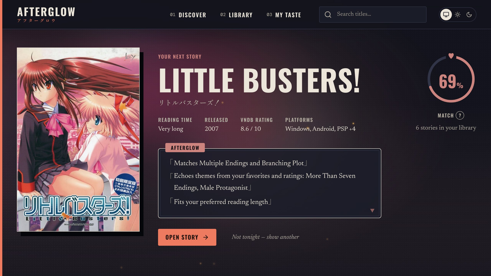
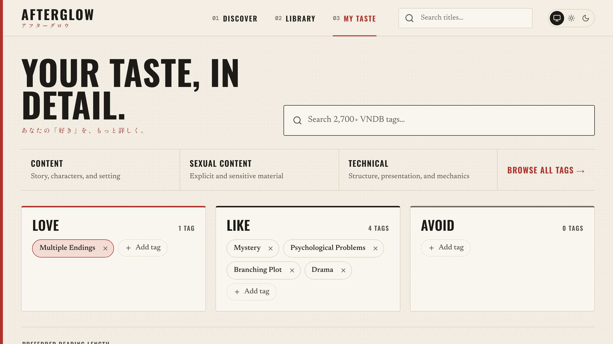
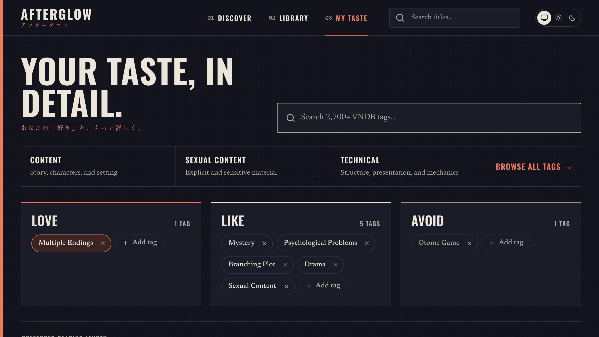

# Afterglow

[**Try the live demo →**](https://afterglow-demo.hstew21.chatgpt.site) — no installation or account required.

The demo saves your library, notes, and taste preferences in your browser. It does not sync across devices, and clearing site data removes your demo saves.

A local-first visual novel discovery app powered by VNDB. Search titles, build a personal library, search VNDB's full tag catalogue, set weighted taste preferences, and get explainable recommendations.

Discover supports paginated results, language, platform, theme and reading-length filters, release years, minimum ratings, and sorting. Your library can be searched by title or private notes, filtered by reading status and favorites, and sorted by rating, progress, title, or recent updates.

The interface comes in light, dark, and system themes. Its decorative motion (page eyecatches, cover glows, drifting petals and light, the typewriter "why it fits you" box) switches off when your device asks for reduced motion.

Recommendations combine manual tag weights with each title's VNDB tag relevance, reading-length and platform preferences, VNDB ratings, and signals learned from favorites, ratings, completed stories, and dropped titles.

## Using your library and recommendations

- **Wishlist:** use the button on a card or the featured story to save it without opening details. An existing story shows its reading status; quick saves never replace your notes, rating, progress, or status.
- **Backup & restore:** open Library and download a JSON backup of your library, notes, taste profile, and recommendation choices. Choose a backup to preview new and matching stories. Restore keeps existing stories and your current taste profile by default. Select the separate replacement and profile options only when you want the backup's versions. Invalid files are rejected before any changes; a failed restore rolls back together.
- **Recommendations:** candidate stories now draw from both your selected themes and themes in favorites and highly rated stories. Avoided themes, low ratings, and spoiler settings remain respected; titles already collected or hidden are excluded, with a bounded wider search when needed.
- **Not tonight / Hide:** Not tonight postpones a story for 24 hours; Hide keeps it out until you restore it. Undo reverses either choice. My taste lists hidden and postponed stories with a Restore action. These choices don't change ratings or reading status.
- **Find by theme:** choose a theme in Discover or use a spoiler-free theme's detail popover to find similar stories. Combine it with language, platform, and other filters.
- **Browse URLs:** filters and result pages are reflected in the address bar and survive refresh. Library filters stay selected when switching views. Browser Back closes details and returns to browsing; Forward reopens them. Copy story link shares a clean URL containing only the VNDB ID.

Backups can move personal data between the local app and the browser demo. The demo still keeps personal data in the browser; use a backup before clearing site data.

## Screenshots

### Discover your next story





### Shape your taste profile





## Start

Requires Node.js 22 or newer.

```bash
npm install
npm run dev
```

Open `http://localhost:5173`. Personal data is stored locally in `data/afterglow.db` and no account or API key is required.

To run the built app from a single server instead:

```bash
npm run build
npm start
```

Then open `http://127.0.0.1:3001`. The API has no accounts, so it only listens on `127.0.0.1` by default. Set `HOST`, `PORT`, or `AFTERGLOW_DATA_DIR` to change the address, port, or database folder.

## Checks

```bash
npm run format:check
npm run lint
npm run typecheck
npm test
npm run build
```

Run `npm run format` to apply Prettier formatting.

## Screenshots

The README screenshots come from your own running copy, so they show real covers:

```bash
npm run build && npm start   # in one terminal
npm run screenshots          # in another; add -- --theme=dark for the -dark versions
```

Run `npm install` after pulling so Playwright is available, and the first time also run `npx playwright install chromium`. The images include your library and taste profile, so look them over before committing.

VN metadata is provided by the [VNDB Kana API](https://api.vndb.org/kana) and remains subject to its terms and data license.
